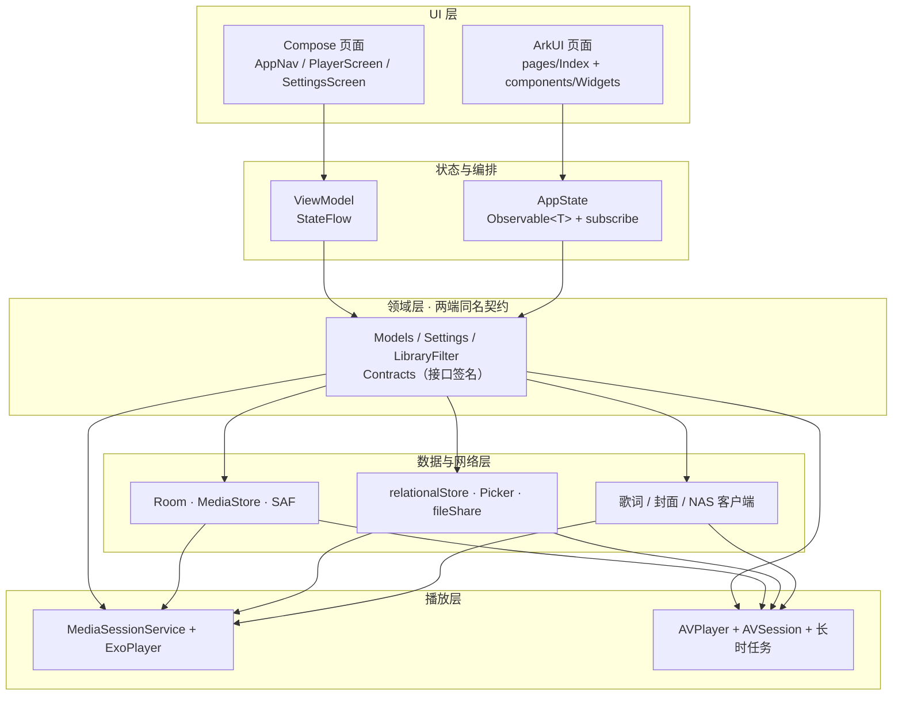

# NasMusic · 本地与 NAS 音乐播放器

一个**离线优先、不依赖商业音乐服务**的音乐播放器，同一套产品设计下提供两个完全独立的原生实现：

| 平台             | 工程目录                                 | 技术栈                                             | 应用标识                   |
| -------------- | ------------------------------------ | ----------------------------------------------- | ---------------------- |
| Android        | [`MusicPlayerApp/`](MusicPlayerApp/) | Kotlin 1.9.24 · Jetpack Compose · Media3 · Room | `com.nasmusic.player`  |
| HarmonyOS NEXT | [`HarmonyMusic/`](HarmonyMusic/)     | ArkTS · ArkUI · AVPlayer · relationalStore      | `com.nasmusic.harmony` |

> 两端**不是**跨平台框架产物，也不共享源码：各自使用该平台原生的媒体、存储、权限与 UI 能力，共用同一套数据模型、交互规范与视觉语言。当前版本均为 **1.7.0**。


---

## 为什么做这个

曲库完全属于用户：本地文件与自建 NAS（SMB / WebDAV）是唯一音源，不接入任何账号体系、不上传收听记录。歌词与专辑封面可选地从公开接口补全，也可以完全关闭。播放、通知/锁屏控制、队列、后台保活全部走系统原生媒体通道，不依赖厂商推送或常驻 Activity。

---

## 核心特性

**曲库**

- 本地音频扫描（Android：MediaStore + SAF；鸿蒙：DocumentViewPicker 目录授权 + AudioViewPicker 导入）
- 19 种音频格式识别（Android）/ 13 种（鸿蒙），读取标题、歌手、专辑、时长、码率、采样率、内嵌封面与内嵌歌词
- 扫描过滤：最短时长阈值（默认 20 秒）、排除文件夹；清理索引只删数据库记录，不动磁盘文件
- 按歌曲 / 专辑 / 歌手 / 文件夹 / 收藏浏览，歌单管理，模糊搜索
- NAS 目录递归扫描（深度上限 12），增量更新与进度回调

**播放**

- 队列、顺序 / 全体循环 / 单曲循环 / 随机、进度拖动、播放记忆（只还原队列与位置，不自动出声）
- Android：`MediaSessionService` + `ExoPlayer`，系统通知与锁屏播控、音频焦点、拔耳机暂停
- 鸿蒙：`AVPlayer` + `AVSession` + `AUDIO_PLAYBACK` 后台长时任务 + WantAgent，锁屏播控与元数据
- NAS 音频缓存（默认上限 512 MB，按文件修改时间淘汰）、睡眠定时（15 / 30 / 60 分钟）

**歌词与封面**

- LRC 逐行同步，支持一行多时间标签、`[offset:]`、纯文本回退；可调时间偏移（±0.5 s）
- 三级装载：应用私有目录 → 同名 `.lrc` → 内嵌歌词；在线自动下载双源并行竞速（LRCLIB / 网易云）
- 在线封面双源竞速（网易云 / iTunes），失败冷却、本地缓存、手动「重新匹配封面」
- 无封面时显示动态极光 + 声波 + 均衡条占位；支持从封面提取主色并叠加到页面渐变

**外观**

- 7 套配色（靛紫 / 海蓝 / 森绿 / 樱粉 / 暖橙 / 石墨 / 动态取色或封面随色）
- 深浅色模式：跟随系统 / 浅色 / 深色 / 定时自动（默认 7:00–19:00 为浅色）
- 沉浸式播放页：启动即播放页、顶部「封面 / 歌词 / 音乐列表」标签、右上角 ⋮ 分组菜单、搜索浮层、队列弹窗、迷你播放器
- 5 个统一同色圆形按键，触点柔光、果冻回弹、主按钮进度环与呼吸光晕；歌词逐行渐变高亮与自动滚动

**安全与隐私**

- NAS 密码：Android `AndroidKeyStore` AES-256-GCM；鸿蒙 `AssetStoreKit`（失败时降级到沙箱内可逆混淆，**非加密**）
- 数据库只保存凭据别名 / 密文，不保存明文密码
- 无账号、无埋点、无广告；仅歌词/封面功能会向第三方发送歌名与歌手

---

## 快速开始

### 直接用现成安装包

| 平台                   | 包格式              | 获取方式                                                              |
| -------------------- | ---------------- | ----------------------------------------------------------------- |
| Android              | `.apk`（debug 签名） | 从源码 `assembleDebug` 构建，或取 Releases 中的归档包                          |
| OpenHarmony / 开发板    | `.hap`（已签名）      | Releases 中的 `NasMusic-Harmony-1.7.0.hap`，`hdc install <file>.hap` |
| 华为零售机 HarmonyOS NEXT | `.hap`（华为签名）     | 需在 DevEco Studio 登录开发者账号自动签名后重新构建，详见 [构建指南](docs/BUILD.md)        |

> 当前仓库附带的 HAP 使用开源 OpenHarmony SDK 与社区自签证书，**零售版华为手机一般无法直接安装**。这不是包损坏，而是签名体系差异。

### 从源码构建

```bash
# Android（JDK 17 + Android SDK 35）
cd MusicPlayerApp
./gradlew assembleDebug --offline

# HarmonyOS NEXT（推荐 DevEco Studio 5.0 / API 12 图形界面）
# 打开 HarmonyMusic/ → 自动同步 → 配置自动签名 → Build Hap(s)
```

完整环境、命令行编译、签名与故障排查见 **[docs/BUILD.md](docs/BUILD.md)**。

---

## 仓库结构

```
.
├── MusicPlayerApp/              # Android 原生工程（Gradle / Kotlin DSL）
│   ├── app/src/main/java/com/nasmusic/player/
│   │   ├── core/                # 模型、设置、过滤规则、手写 DI 容器
│   │   ├── data/                # Room、扫描、标签、NAS、歌词、封面
│   │   │   └── db/
│   │   ├── playback/            # MediaSessionService / MediaController / NAS DataSource
│   │   └── ui/                  # Compose 页面、组件、主题、ViewModel
│   └── app/src/main/res/
├── HarmonyMusic/                # HarmonyOS NEXT 原生工程（Stage 模型）
│   ├── AppScope/                # 应用级配置与图标
│   ├── entry/src/main/ets/
│   │   ├── common/              # 模型、工具、主题、全局状态、接口契约
│   │   ├── data/                # RDB、设置、凭据、扫描、缓存、网络协议
│   │   ├── playback/            # AVPlayer / AVSession / 播放动作
│   │   ├── components/          # 可复用 ArkUI 组件
│   │   ├── pages/Index.ets      # 唯一 @Entry，页面状态机
│   │   └── entryability/
│   └── entry/src/main/resources/
├── docs/
│   ├── ARCHITECTURE.md          # 架构与实现细节
│   ├── BUILD.md                 # 构建、签名、安装、故障排查
│   └── CHANGELOG.md             # 版本历史
└── README.md
```

---

## 技术栈

| 层       | Android                                           | HarmonyOS NEXT                                 |
| ------- | ------------------------------------------------- | ---------------------------------------------- |
| 语言 / UI | Kotlin 1.9.24 · Compose Material3（BOM 2024.06.00） | ArkTS · ArkUI 声明式 UI                           |
| 构建      | Gradle 8.9 · AGP 8.6.1 · KSP 1.9.24-1.0.20        | hvigor 5.x · API 12                            |
| 播放      | Media3 1.3.1（ExoPlayer / Session）                 | `@kit.MediaKit` AVPlayer · `@kit.AVSessionKit` |
| 数据库     | Room 2.6.1（`nasmusic.db`）                         | `relationalStore`（`harmonymusic.db`）           |
| 配置      | DataStore Preferences + SharedPreferences         | `@kit.ArkData` preferences                     |
| 网络      | OkHttp 4.12.0 · SMBJ 0.11.5                       | `@kit.NetworkKit` http / TCPSocket（手写 SMB2）    |
| 图片      | Coil 2.6.0                                        | `@kit.ImageKit`                                |
| 凭据      | AndroidKeyStore AES-GCM                           | `@kit.AssetStoreKit`                           |
| 异步      | Coroutines / Flow / StateFlow                     | Promise / async-await · 轻量 `Observable<T>`     |

两端均**零第三方 UI 框架依赖**；鸿蒙端 `oh-package.json5` 的运行时依赖为空。

---

## 架构概览



分层原则：`common/core` 只定义模型与契约，不反向依赖实现；UI 通过状态容器订阅变化，不直接持有播放器实例；播放层与数据层通过契约解耦。详见 **[docs/ARCHITECTURE.md](docs/ARCHITECTURE.md)**。

---

## 第三方服务声明

歌词与封面功能会向以下公开接口发起 GET 请求（仅发送歌名、歌手；可整体关闭）：

| 用途        | 接口                                                               | 备注                  |
| --------- | ---------------------------------------------------------------- | ------------------- |
| 歌词搜索      | `https://lrclib.net/api/search?track_name=...`                   | 开放服务                |
| 歌词搜索 / 详情 | `https://music.163.com/api/search/get?...`、`/api/song/lyric?...` | **非官方私有接口**，可能变更或限流 |
| 封面搜索      | 同上网易云搜索、`https://itunes.apple.com/search?...`                    | iTunes Search API   |

这些接口与本仓库无任何关联，使用前请自行评估其服务条款与可用性；接口失效时播放器会静默降级（歌词空、封面占位），不影响本地播放。

---

## 已知限制

| 范围             | 说明                                                                                                                           |
| -------------- | ---------------------------------------------------------------------------------------------------------------------------- |
| 验证程度           | 两端均**未在真机 / 模拟器上完成完整验收**：UI 动效、锁屏播控、NAS 握手、在线歌词/封面仅有编译期与静态校验                                                                 |
| Android 签名     | `app/build.gradle.kts` 未配置 `signingConfigs`，仅有 debug 签名产物；release 未启用混淆；Room `fallbackToDestructiveMigration()`，schema 变更会清库 |
| Harmony 签名     | 现成 HAP 为 OpenHarmony SDK + 自签证书，零售 HarmonyOS NEXT 需华为签名后重建                                                                   |
| Harmony SMB    | 手写 SMB2 只读客户端的 NTLMv2 / 消息签名**未经真机兼容性验证**；强制签名或 SMB3 加密共享需扩展                                                                 |
| Harmony NAS 播放 | 当前为「整文件下载到本地缓存后用 `fdSrc` 播放」，不是流式边下边播                                                                                        |
| 凭据降级           | 鸿蒙端 AssetStoreKit 不可用时降级为沙箱内可逆混淆，安全性依赖应用沙箱                                                                                   |
| 在线依赖           | 歌词/封面依赖外网；国内访问 LRCLIB 可能超时并触发 3 分钟熔断，由网易云兜底                                                                                  |
| 其它             | 睡眠定时为 ViewModel 内秒级计时、不持久化；歌词/封面缓存与熔断为进程内内存态，重启失效                                                                            |

完整的限制清单与改进方向见 [架构文档「已知限制」](docs/ARCHITECTURE.md#15-已知限制与改进方向)。

---

## 文档

- [架构与实现细节](docs/ARCHITECTURE.md) — 数据模型、播放链路、网络协议、主题算法、平台差异
- [构建与签名指南](docs/BUILD.md) — 环境、命令行编译、HAP 签名、安装、故障排查
- [版本历史](docs/CHANGELOG.md)

---

## 发布前检查

本仓库尚需维护者补充以下内容后公开：

1. `LICENSE` —— 当前**未内置许可文件**，请按你的意愿选择（MIT / Apache-2.0 / GPL 等）并同步修改本文末尾的许可说明。
2. 截图 —— 建议把真机截图放入 `docs/screenshots/` 并在本文顶部引用。
3. Releases —— 二进制包（`.apk` / `.hap`）已被 `.gitignore` 排除，请通过 GitHub Releases 分发而非提交进仓库。
4. `local.properties` —— 含本机 SDK 绝对路径，已被忽略，切勿强制提交。
5. 签名材料 —— `.p12` / `.cer` / `.p7b` / `.keystore` 均已被忽略，严禁入库。

## License

尚未指定。请在发布前添加 `LICENSE` 文件；在添加之前，本仓库内容默认保留所有权利。
